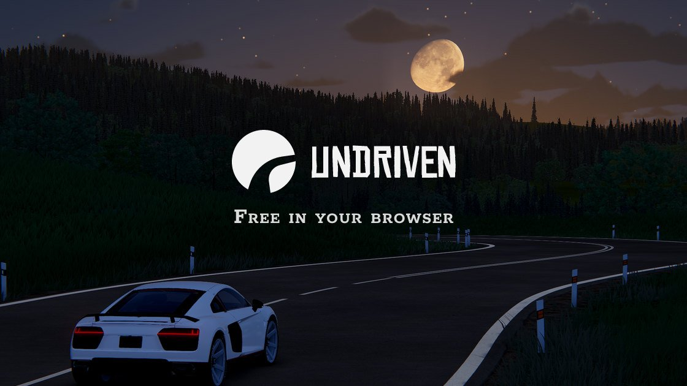
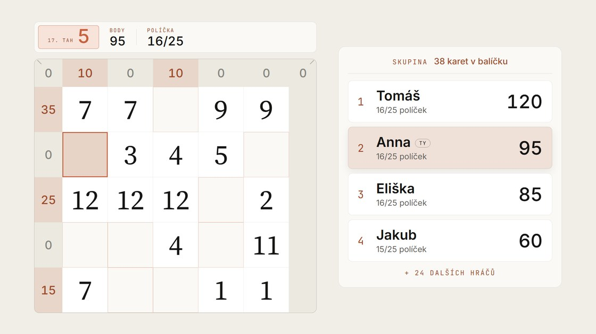
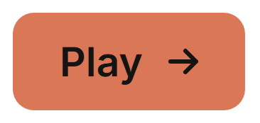

## Hi, I'm Martin

Frontend developer from the Czech Republic who builds games and interactive products for the web. I design in Figma, build with TypeScript and care about the details, from frame rate to pixel spacing.

[undriven.io](https://undriven.io) · [matematickypoker.cz](https://matematickypoker.cz) · sikula.martin@email.cz

### Featured projects

<table>
  <tr>
    <td width="50%" valign="top">
      
      <h3><a href="https://undriven.io">Undriven</a></h3>
      
Free open-world driving game in the browser. Endless procedurally generated roads through forests, fields and mountains, day and night, sun and storms. Plays on desktop and mobile.

      
   

      
    </td>
    <td width="50%" valign="top">
      
      <h3><a href="https://matematickypoker.cz">Matematický poker</a></h3>
      
Number game on a 5×5 grid: place cards 1–13 and score poker hands in every row, column and diagonal. Server-validated leaderboard, daily challenge, 1v1 duels, lobbies for up to 50 players, 6 languages, installable PWA.

      
  

      
    </td>
  </tr>
</table>

### Stack

**Languages** 

**Frontend & 3D** 

**Backend & cloud** 

**Design & tools** 

Also: GLSL shaders · Rapier physics · Framer Motion · Cloudflare D1 · Gemini API · Playwright · PWA
